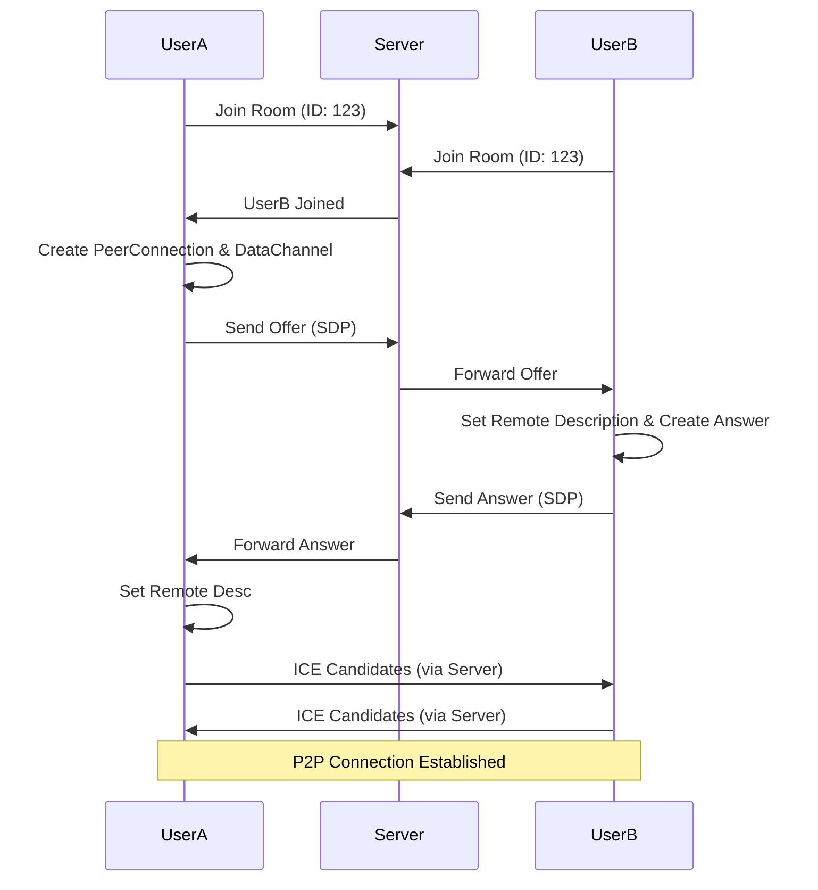

# Window - Real-time P2P File Sharing

Window is a modern, secure, and ephemeral file-sharing application that enables users to share files directly between devices using WebRTC. It features a room-based architecture where users can join a shared space and exchange files without any intermediate storage server.

## 🚀 Key Features

- **Peer-to-Peer Transfer:** Files are transferred directly between users using WebRTC Data Channels. No files are ever stored on the server.
- **Room-Based Sharing:** Users join unique rooms via UUIDs to connect with peers.
- **Ephemeral Identity:** User identities are temporary and session-based. Reloading the page maintains the session, but closing the tab clears the room state.
- **Multi-Channel Architecture:** Large files and multiple files are distributed across multiple data channels for efficient transfer.
- **Secure & Private:** Direct P2P connection ensures data privacy. The signaling server only brokers the initial connection.

## 🛠 Tech Stack

### Frontend (`window-ui`)

- **Framework:** React (Vite)
- **State Management:** Zustand (with `sessionStorage` persistence)
- **Routing:** TanStack Router
- **Styling:** Tailwind CSS, Framer Motion, Shadcn UI
- **Protocol:** WebRTC (RTCPeerConnection, RTCDataChannel)

### Backend (`server`)

- **Runtime:** Node.js
- **WebSocket:** `ws` library
- **Role:** Signaling Server (Relays SDP offers/answers and ICE candidates)

## 🏗 Architecture & Flow

### 1. Signaling Flow

The Node.js server acts as a broker to help peers find each other. It does not touch the file data.



### 2. File Transfer Logic

The application uses a robust multi-channel approach to handle file transfers efficiently.

- **Chunking:** Files are split into chunks (default 16KB) to prevent blocking the main thread and ensure smooth transmission.
- **Round-Robin Distribution:** When sending multiple files, they are distributed across available data channels to maximize throughput.
- **Backpressure Handling:** The sender monitors the `bufferedAmount` of the data channel. If the buffer fills up (e.g., >10MB), sending pauses until the buffer drains, preventing memory overflows.

### 3. Session Management & Cleanup

- **Persistence:** `userId` and `userName` are stored in `sessionStorage`. This allows users to reload the page without losing their identity or connection to the room.
- **Graceful Cleanup:**
  - `beforeunload`: Triggers a browser confirmation dialog to prevent accidental exits.
  - `pagehide`: Fires when the user confirms exit, triggering the `cleanUp` function to close WebSockets and PeerConnections immediately.
  - This prevents "zombie" peers from lingering in the room state on the server.

## 🚀 Getting Started

### Prerequisites

- Node.js (v18+)
- pnpm (or npm/yarn)

### 1. Start the Signaling Server

```bash
cd server
pnpm install
pnpm dev
# Server runs on port 8080
```

### 2. Start the Frontend Client

```bash
cd window-ui
pnpm install
pnpm dev
# Client runs on http://localhost:5173
```

## 🤝 Contributing

Contributions are welcome! Please feel free to submit a Pull Request.
