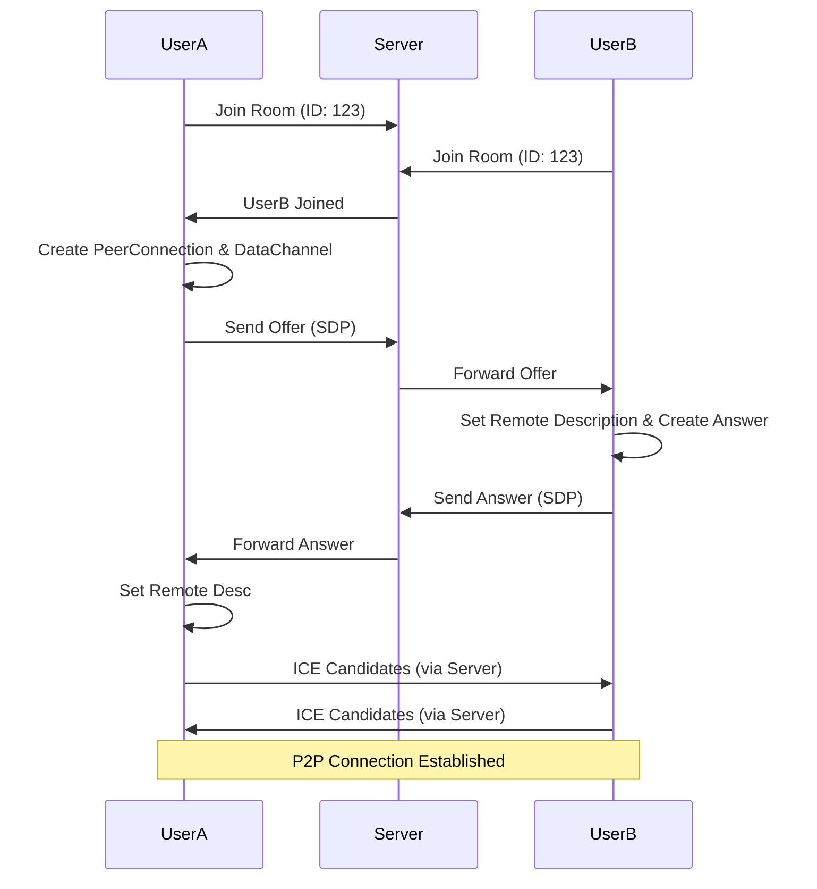

# Window - Real-time P2P File Sharing

Window is an ephemeral file-sharing application that lets people exchange files directly between devices using WebRTC. Users create or join a room and transfer files without storing file contents on the signaling server.

## 🚀 Key Features

- **Peer-to-Peer Transfer:** Files are transferred directly between users using WebRTC Data Channels. File contents are not uploaded to or stored on the signaling server.
- **Room-Based Sharing:** Users join unique rooms via UUIDs to connect with peers.
- **Pull-Based Offers:** Peers can make files available to the room or selected recipients. Recipients request a transfer, and the sender can accept or reject it. Offers last up to one hour and are removed when revoked, expired, or the sender leaves.
- **Ephemeral Identity:** User identity is scoped to the browser tab session. Reloading the page preserves the session; leaving the room or closing the tab ends it.
- **Multi-Channel Architecture:** Large files and multiple files are distributed across multiple dynamically created data channels for efficient transfer.
- **Recipient Controls:** Offers can be visible to the whole room or restricted to selected peers. Rooms support up to six peers.
- **Transfer Limits:** Send up to five files at once. A single file can be up to 50 MB; files in a batch can be up to 6 MB each. Offers are limited to 50 MB each.
- **Network Traversal:** STUN is enabled by default. A TURN service can be configured for networks that block direct peer connections.

## 🛠 Tech Stack

### Frontend (`window-ui`)

- **Framework:** React (Vite)
- **State Management:** Zustand (with `sessionStorage` persistence)
- **Routing:** TanStack Router
- **Styling:** Tailwind CSS, Framer Motion, Shadcn UI, Lucide React
- **Notifications:** Sonner
- **Protocol:** WebRTC (RTCPeerConnection, RTCDataChannel)

### Backend (`server`)

- **Runtime:** Node.js
- **WebSocket:** `ws` library
- **Role:** Signaling Server (Relays SDP offers/answers and ICE candidates)

## 🏗 Architecture & Flow

### 1. Signaling Flow

The Node.js server acts as a broker to help peers find each other. It does not touch the file data.

Pull-based offers keep file contents in the sender's active browser session. The signaling server stores only temporary offer metadata and access rules; it does not receive file contents. Recipients can pull an offered file while the sender is online and before its expiry.

For networks that block direct peer connections, configure a TURN service on the signaling server. Set `TURN_URLS` to a comma-separated list of TURN URLs (for example, `turn:turn.example.com:3478?transport=udp,turns:turn.example.com:5349?transport=tcp`) and `TURN_SHARED_SECRET` to the TURN provider's shared secret. The `/ice-servers` endpoint generates time-limited (one hour) REST credentials for clients. Without both settings, clients continue to use STUN only. The TURN service itself must be provisioned separately; relay traffic may incur provider costs.



### 2. File Transfer Logic

The application uses a robust multi-channel approach to handle file transfers efficiently.

- **Chunking:** Files are split into chunks (default 64KB) to prevent blocking the main thread and ensure smooth transmission.
- **Round-Robin Distribution:** When sending multiple files, they are distributed across available data channels to maximize throughput.
- **Backpressure Handling:** The sender monitors the `bufferedAmount` of the data channel. If the buffer fills up (e.g., >10MB), sending pauses until the buffer drains, preventing memory overflows.

### 3. Session Management & Cleanup

- **Persistence:** `userId` and `userName` are stored in `sessionStorage`. This allows users to reload the page without losing their identity or connection to the room.
- **Graceful Cleanup:**
  - `beforeunload`: Triggers a browser confirmation dialog to prevent accidental exits.
  - `pagehide`: Fires when the user confirms exit, triggering the `cleanUp` function to close WebSockets and PeerConnections immediately.
  - This prevents "zombie" peers from lingering in the room state on the server.

## 🚀 Getting Started

### Prerequisites

- Node.js (v18+)
- pnpm

### 1. Start the Signaling Server

```bash
cd server
pnpm install
pnpm dev
# Server runs on port 8080
```

### 2. Start the Frontend Client

```bash
cd window-ui
pnpm install
pnpm dev
# Client runs on http://localhost:3000
```

The frontend connects to `localhost:8080` by default. To use a different signaling host or port, set `VITE_SERVER_PATH` (host and port, without a URL scheme) or `VITE_SERVER_PORT` in `window-ui/.env.local` before starting Vite.

### Search and social metadata

The public homepage is listed in `window-ui/public/sitemap.xml`. Room URLs are excluded from indexing because they contain temporary sharing IDs. Set `VITE_SITE_URL` to the deployed site's public origin (for example, `https://files.example.com`) in `window-ui/.env.production` or the deployment environment before building. This value populates the canonical URL, social preview URLs, `robots.txt`, and the sitemap. The build fallback is `http://localhost:3000`, which is suitable only for local development.

For TURN relay support, configure `TURN_URLS` and `TURN_SHARED_SECRET` on the signaling server. The server returns short-lived TURN credentials from `/ice-servers`.

### Connecting a second device on your Wi-Fi

For the LAN setup, host the UI and signaling server on the development machine and open the UI from the other device using the host machine's LAN IP. The current manual setup and an optional mDNS-based discovery design are described in the [Local Development Guide](docs/local-development.md).

## 🤝 Contributing

Contributions are welcome! Please feel free to submit a Pull Request.
