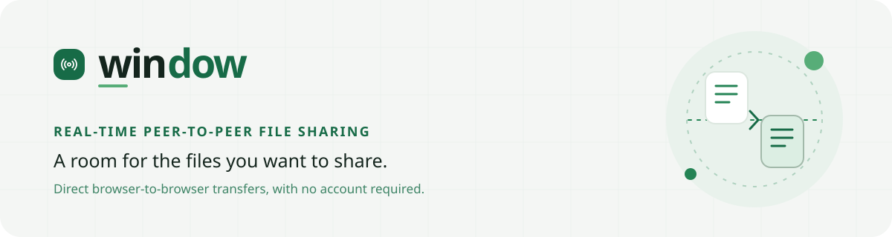
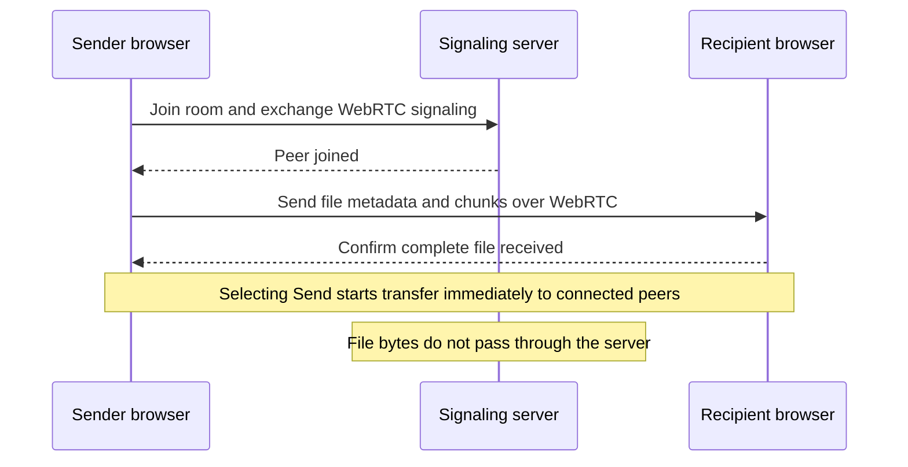
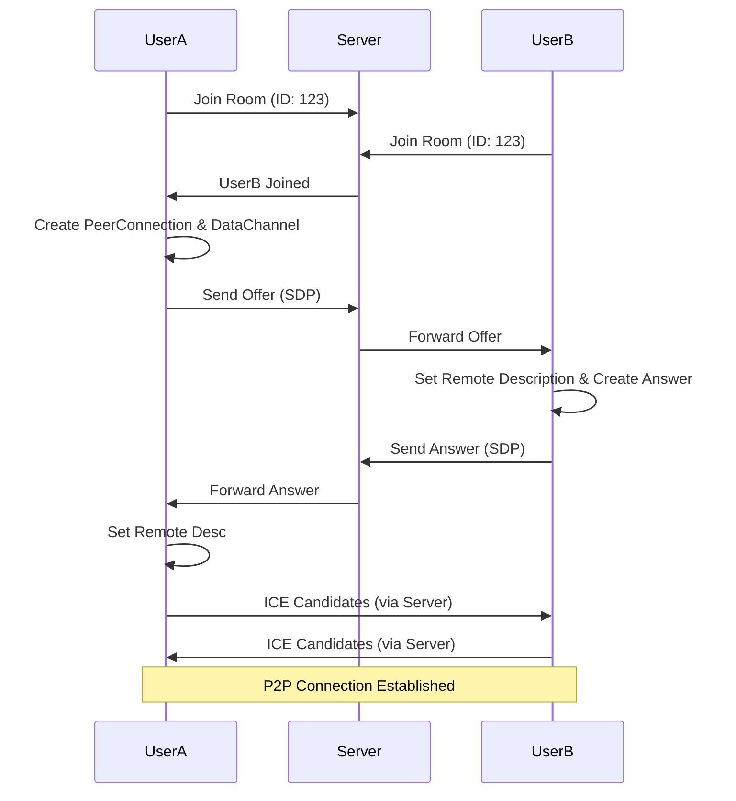

# Window - Real-time P2P File Sharing

Window is an ephemeral file-sharing application that lets people exchange files directly between devices using WebRTC. Users create or join a room and transfer files without storing file contents on the signaling server.

## 🚀 Key Features

- **Peer-to-Peer Transfer:** Files are transferred directly between users using WebRTC Data Channels. File contents are not uploaded to or stored on the signaling server.
- **Two transfer modes:** Send files immediately to connected peers, or publish an offer that an authorized recipient can download while you are online.
- **Room-Based Sharing:** Users join UUID rooms with up to six participants. Share the room ID or invite URL with people who should join.
- **Pull-Based Offers:** Offers can be visible to the room or selected peers and last 5, 10, 15, or 60 minutes. A download request starts automatically when the owner is online and the peer connection is ready; there is no approval prompt.
- **Ephemeral Identity:** User identity is scoped to the browser tab session. Reloading the page preserves the session; leaving the room or closing the tab ends it.
- **Transfer limits:** Immediate send accepts up to five files: one file may be up to 50 MB, while each file in a multi-file batch is limited to 6 MB. Pull offers allow up to five files per action, each up to 50 MB, with at most 200 MB of active offers per sender.
- **Interface:** Responsive room view, connected-peer roster, system/light/dark theme, copyable room IDs and invite links, and transfer progress.
- **Network traversal:** STUN is enabled by default. A TURN service can be configured for networks that block direct peer connections.

## 🛠 Tech Stack

### Frontend (`window-ui`)

- **Framework:** React (Vite)
- **State Management:** Zustand (with `sessionStorage` persistence)
- **Routing:** TanStack Router
- **Styling:** Tailwind CSS, Framer Motion, Shadcn UI, Lucide React
- **Notifications:** Sonner
- **Protocol:** WebRTC (RTCPeerConnection, RTCDataChannel)

### Backend (`server`)

- **Runtime:** Node.js
- **WebSocket:** `ws` library
- **Role:** Signaling Server (Relays SDP offers/answers and ICE candidates)

## 🏗 Architecture & Transfer Modes

Window supports two ways to share files. **Send files** pushes the selected files to every connected peer. **Available files** publishes file metadata so an authorized peer can request a download later, while the sender remains in the room.

### Immediate send (push)



The sender selects files and chooses **Send**. Window sends them to all connected peers; recipients do not need to request or approve the transfer. Each recipient gets a separate peer-to-peer transfer. The sender can send up to five files at once. A single file can be up to 50 MB; in a multi-file batch, each file can be up to 6 MB.

### Available file (pull)

```mermaid
sequenceDiagram
    participant A as File owner browser
    participant S as Signaling server
    participant B as Recipient browser
    A->>S: Publish offer metadata and audience
    S-->>B: Show offer to authorized room members
    B->>S: Request download
    S-->>A: Forward request
    A->>S: Accept automatically if file and peer are available
    S-->>B: Transfer can start
    A->>B: Send file chunks over WebRTC
    B-->>A: Confirm completion
    Note over A,S: Owner must stay online; offer expires or can be revoked
    Note over S: File bytes do not pass through the server
```

Choose **Available files** to publish up to five files per action. Offers are visible to everyone in the room or only selected peers. The owner’s browser keeps each offered `File` in memory; the server holds only offer metadata. Downloads start automatically when the owner is online and the peer connection is ready. A sender can have at most three active pull transfers. A recipient can have one pull request or download in progress at a time.

Offers expire after the selected 5, 10, 15, or 60 minutes, and can be revoked sooner. They are removed when the owner leaves. Each offered file is limited to 50 MB; active offers are limited to 20 per owner and 200 MB total. Offers and file contents are not persisted across server or browser restarts.

### Connection and signaling flow

The Node.js server acts as a broker to help peers find each other. It does not touch the file data.

Pull-based offers keep file contents in the sender's active browser session. The signaling server stores only temporary offer metadata and access rules; it does not receive file contents. Recipients can pull an offered file while the sender is online and before its expiry.

For networks that block direct peer connections, configure a TURN service on the signaling server. Set `TURN_URLS` to a comma-separated list of TURN URLs (for example, `turn:turn.example.com:3478?transport=udp,turns:turn.example.com:5349?transport=tcp`) and `TURN_SHARED_SECRET` to the TURN provider's shared secret. The `/ice-servers` endpoint generates time-limited (one hour) REST credentials for clients. Without both settings, clients continue to use STUN only. The TURN service itself must be provisioned separately; relay traffic may incur provider costs.



### File transfer details

The signaling server routes room membership and WebRTC setup messages. Once a peer connection is established, file content travels through WebRTC data channels. Push sends use up to five channels per recipient, distributing files round-robin; files on each channel are sent in sequence. Pull transfers use the peer’s existing data channel.

- **Chunking and integrity:** Files are read in chunks of up to 64 KB, with 36 bytes of framing per chunk for the sequence number and SHA-256 checksum. Receivers check chunk order, checksum, declared file size, and completion before downloading.
- **Backpressure:** A sender pauses when a data-channel buffer grows beyond 10 MB, then resumes when it drains. A 30-second stalled buffer can interrupt a transfer.
- **Completion:** Push waits for a receiver confirmation and times out if it does not arrive within two minutes. Pull sends a completion message through the signaling server after the recipient validates the transfer.
- **Browser memory:** Incoming chunks are assembled into a browser `Blob` before the download begins. Keep available memory in mind for large files.

### Session management and cleanup

- The anonymous user ID, display name, and identity proof are stored in tab-scoped `sessionStorage`, so a page reload can reuse the identity.
- Leaving the room or closing the tab closes peer connections and the signaling socket. The server removes the member, their offers, and related pending pulls.
- Navigating away triggers a browser leave confirmation. Room IDs and invite URLs contain the room UUID; room routes are excluded from search indexing.

### Privacy and server state

- File bytes are sent over WebRTC data channels and are not sent to the signaling server. WebRTC data channels use DTLS encryption between peers.
- The signaling server does receive room IDs, display names, file offer metadata (name, type, size, audience, and expiry), and WebRTC connection-signaling data. It keeps room membership, offers, pull requests, and identity proofs in process memory; these are not a durable file store.
- The server issues a random identity proof to a tab and checks it when that identity reconnects. This prevents another connection from claiming an already-known identity; it does not authenticate people or protect a room from someone who has its ID.
- Anyone with a room ID can attempt to join until the room reaches six participants. Rooms have no password or account-based access control. Use selected-recipient offers for narrower file visibility, and only share room links with intended participants.
- Direct peer connections depend on both networks. STUN is used by default; TURN can relay WebRTC traffic when a direct path cannot be established. A TURN provider may see relayed traffic and may charge for it.

## 🚀 Getting Started

### Prerequisites

- Node.js (v18+)
- pnpm

### 1. Install workspace dependencies

```bash
pnpm install
pnpm build:shared
```

### 2. Start the Signaling Server

In one terminal, from the repository root:

```bash
pnpm dev:server
# Server runs on port 8080
```

### 3. Start the Frontend Client

In another terminal, from the repository root:

```bash
pnpm dev:frontend
# Client runs on http://localhost:3000
```

The frontend connects to `localhost:8080` by default. To use a different signaling host or port, set `VITE_SERVER_PATH` (host and port, without a URL scheme) or `VITE_SERVER_PORT` in `window-ui/.env.local` before starting Vite.

The `shared` workspace package contains the room, signaling, offer, and transfer message types used by both client and server. Build it once with `pnpm build:shared` after installing dependencies. For production builds, use `pnpm build:frontend` and `pnpm build:server`. Run the frontend tests with `pnpm --filter window-ui test`, server tests with `pnpm --filter window-server test`, or type checks across workspaces with `pnpm typecheck`.

The signaling server also exposes `GET /health` for a basic health response and `GET /ice-servers` for the STUN/TURN configuration used by browsers. Set `PORT` to change the server's listening port. On an HTTPS UI, the browser connects to the signaling server over secure WebSockets (`wss`).

### Search and social metadata

The public homepage is listed in `window-ui/public/sitemap.xml`. Room URLs are excluded from indexing because they contain temporary sharing IDs. Set `VITE_SITE_URL` to the deployed site's public origin (for example, `https://files.example.com`) in `window-ui/.env.production` or the deployment environment before building. This value populates the canonical URL, social preview URLs, `robots.txt`, and the sitemap. The build fallback is `http://localhost:3000`, which is suitable only for local development.

For TURN relay support, configure `TURN_URLS` and `TURN_SHARED_SECRET` on the signaling server. The server returns short-lived TURN credentials from `/ice-servers`.

### Network and transfer troubleshooting

- **Room stays disconnected:** Confirm the UI can reach the signaling server at `VITE_SERVER_PATH`, and check `GET /health` on the server.
- **Peers join but cannot transfer:** WebRTC needs a direct route between browsers. Check local firewall and network restrictions; configure TURN if direct connections are blocked.
- **Pull offer is unavailable:** The owner must remain in the room with the original tab open. Offers disappear at expiry, when revoked, or when the owner leaves.
- **Transfer stops:** Keep both tabs open and connected. Buffer stalls, lost peer connections, or browser memory limits can interrupt large transfers. Retry after the peer connection recovers.
- **Room is full:** Rooms accept up to six participants, including the person who created the room. Leave an existing room or create a new one.
- **More than one selected file has the same name:** The immediate-send list keeps only one file per filename.

### Connecting a second device on your Wi-Fi

For the LAN setup, host the UI and signaling server on the development machine and open the UI from the other device using the host machine's LAN IP. The current manual setup and an optional mDNS-based discovery design are described in the [Local Development Guide](docs/local-development.md).

## 🤝 Contributing

Contributions are welcome! Please feel free to submit a Pull Request.
